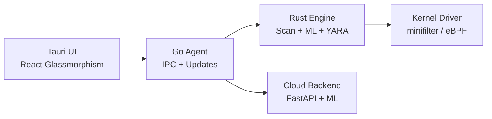

<div align="center">


[](https://github.com/cokovali10-sketch/TitanDefender)

[](https://rust-lang.org)
[](https://tauri.app)
[](https://react.dev)
[](LICENSE)

</div>

---

## 🛡️ TitanDefender

Современный антивирус с glassmorphism-интерфейсом. Real-time защита, YARA-сигнатуры, ML-классификация, песочница, EDR-телеметрия, анти-рансомварь.

**Статус:** 🚧 В разработке (Phase 1 — Core Engine)

---

## ✨ Planned Features

- 🔴 Real-time on-access scanning
- 🟣 Full / Quick / Custom scans
- 🟢 YARA + hash + heuristic + ML detection
- 🔵 Cloud reputation
- 🟠 Sandbox (dynamic analysis)
- 🟡 Quarantine + restore
- 🟢 EDR telemetry (MITRE ATT&CK)
- 🔴 Anti-ransomware (canary files)
- 🟣 Web protection + anti-phishing
- 🔵 Parental control, firewall, optimizer

---

## 🏗️ Architecture



---

## 📦 Build

```bash
# Engine
cd engine && cargo build --release

# UI
cd ui && npm install && npm run tauri build
```

---

## 📄 License

MIT


## ?? ????????????? ? ??????? ????????????

TitanDefender ???????? ? **user-mode** ?? ?????????:
- ?? ????????????? kernel-??????? (minifilter) ?????????????
- ?? ????????? Windows Defender ??? ?????? AV
- ?????? ?????? ????? (?????????? ?????)
- ????? ???????? ??????????? ? Kaspersky, Windows Defender, Avast ? ??.

???????? "????? ?????????????" ? ?????????? ??? ???????????? overhead ??? ??????? ?????? AV.
